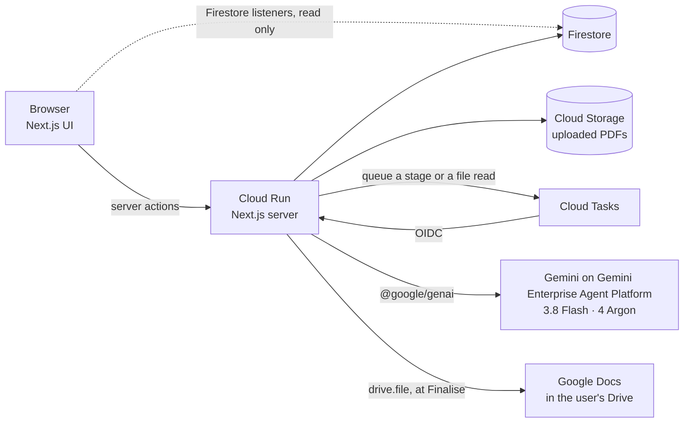

# FlowHub

**The hub for everything a company sells, with an agent team built in.**

Staff keep every offering in one place, as a structured, sourced catalogue. When an opportunity arrives, Gemini agents research the prospect with cited sources, map its needs to the company's own priced offerings, and draft the proposal into Google Docs. A person approves every stage.

Built for **AI Builder Cup 2026**, Theme 5: Future of Work & Enterprise Productivity.

**Live app:** https://flowhub-331382621697.asia-southeast1.run.app. Sign in with any Google account and choose **Try with sample data**. There are three sample sellers: one sells services, one software, one products. Every sample company, person and price is fictional. Olvessa Cloud's sample comes with a real prospect, MR D.I.Y., waiting at Gate A: press **Research this prospect** to watch a cited brief build live from public web sources.

## What it does

**1. The hub.** Each offering has one page with six tabs: Overview, Scope, Pricing, Partners, Sales material and Notes. Under the pages is a typed offering graph:
- offerings and features
- rate cards and fee schedules
- results you can cite, each marked public or not
- exclusions, selling rules and partners

Every entity records where it came from and who confirmed it. A source chip opens the document at the cited page, with the quote it was read from. On the Notes tab, Gemini summarises the team's notes into what sells, what loses deals and what to watch, and every line links to the notes behind it.

**2. Ask or tell.** Press Ctrl+J anywhere, type a sentence, or drop a PDF:
- *"From 1 November our Growth landing zone goes up to RM 19,500."* FlowHub proposes exactly one change to that price cell, effective 1 November, and warns about open deals priced at the old rate.
- *"Met Farah at Anjung Serai Living today…"* FlowHub proposes a new opportunity with the contact and next meeting, plus notes on the offerings they asked about.
- *"What's our Growth price for 80 VMs?"* The answer copies the line from the rate card, and code calculates 80 × RM 380 = RM 30,400.
- **A brochure PDF.** FlowHub proposes new features, price lines and results, each citing its page.

Nothing changes until a person presses Apply, and every applied change can be undone.

**3. The deal room.** Paste an email or invite, attach an RFP, or enter a website. Four stages follow, each ending at a gate where a person approves, edits or stops:

| Stage | Agent roles | Gate |
|---|---|---|
| Intake | Intake reads the text, file or website and extracts the company, contacts and requirements, with the PDF page of each | A: confirm the prospect |
| Research | Researcher runs Google Search grounding in parallel. Each claim keeps its sources | B: approve the brief |
| Fit and pricing | Fit Analyst maps needs to offerings, including Cannot meet. Pricing picks lines through function calls | C: approve the fit and price |
| Write and review | Writer drafts. Reviewer checks every claim against the research and the catalogue, and code runs hard checks | D: finalise into a Google Doc |

At Gate C a person can change a fit, add a need, map it to another offering or price a line at another tier, and the score is recalculated in code. Any gate can be reopened without a new AI run, or the stage run again. After the proposal, FlowHub drafts a follow-up email that restates only the proposal's own claims and never states a price. FlowHub never sends it.

## Why you can trust what it writes

These rules are enforced in code. Unit tests and an eval check them. They're not left to a prompt.

- **Prices are copied, never typed.** Models pick line references, and code copies the price text word for word and does every sum. A price in a message or PDF must appear word for word in its source, or the change is dropped.
- **Cost stays private.** Cost cards, cost fields and buy prices never reach a model or a generated document.
- **Research is cited.** Claims are cut from Google Search grounding metadata. A sentence with no grounding is dropped and counted, and source links are kept exactly as Google returned them.
- **Unsupported claims are blocked.** Every claim in a draft is backed by research, the catalogue, or a person's explicit choice at Gate D. Anything else blocks the document.
- **Roadmap features are never sold as available.** A sentence that rests only on a planned feature goes to a person at Gate D, who keeps it only if it says "on our roadmap".
- **Only public results are cited.** A result marked Not public never reaches a document.
- **People apply changes.** Agents read only confirmed catalogue data. Everything they suggest is a proposal until someone applies it.
- **Scores and selling rules are code.** The go/no-go score is a formula. A prospect that breaks a company-wide selling rule (industry or region) is held at No-go.
- **Google tokens are never stored.** The Drive token is a narrow `drive.file` grant. It's used once, at Finalise, and never stored or logged.

## Evaluation

`npm run eval` runs the real pipelines against Gemini on six opportunities and six Ask or tell messages. Each seller's sample catalogue is held in memory, so the eval never touches a database. Results on 2026-10-16:

| Check | Result | Target |
|---|---|---|
| Prospect identified | 6 / 6 | 90% |
| Need mapped to the expected offering | 31 / 32 | 80% |
| Selling-rule and scope conflicts caught | 7 / 7 | 100% |
| Prices traced to a rate card cell or fee line | 48 / 48 | 100% |
| Calculated totals correct | 11 / 11 | 100% |
| Planted unsupported claims flagged by the Reviewer | 9 / 9 | 100% |
| Drafts with a cost amount | 0 / 6 | 0 |
| Non-public results cited | 0 / 12 | 0 |
| Ask or tell messages giving exactly the expected changes | 6 / 6 | 5 of 6 |

One message plants a percentage price rise, *"put it up by 10%"*. No price change reaches Apply, because the person never wrote the new price.

## Architecture



- **One Next.js service on Cloud Run** serves the UI and runs the agent pipelines. The pipelines are TypeScript steps orchestrated in code, with a person at every gate.
- **Long stages and PDF reads** are queued through Cloud Tasks. Each run is stateless: it reads its inputs from Firestore and writes its progress and results back.
- **Writes come only from the server.** The browser never writes to Firestore and never calls a model.
- **Gemini features used:**
  - Google Search grounding
  - URL context
  - file understanding (PDFs, including scanned pages, and images)
  - structured output, from the same Zod schemas the app validates with
  - function calling

  Gemini 4 Argon reasons (fit, inferences, writing, review). Gemini 3.8 Flash handles intake, extraction, pricing selection and Ask or tell.
- **The catalogue schema** is Zod. It generates the published exchange format in [`docs/schema/`](docs/schema/offering-graph.v1.schema.json).

More detail is in [`docs/architecture.md`](docs/architecture.md). The decisions are in [`docs/adr/`](docs/adr), and the product requirements in [`docs/product/PRD.md`](docs/product/PRD.md).

## Run it locally

You need Node 24 or later, a Google Cloud project with the Gemini models enabled, and a Firebase project for development data (see [ADR-0011](docs/adr/0011-local-development-on-a-dev-project.md)).

```bash
cd web
npm install
cp .env.example .env.local      # then fill in your project IDs and Firebase web config
gcloud auth application-default login
npm run dev
```

| Command | What it does |
|---|---|
| `npm test` | Unit tests (Vitest) |
| `npm run lint`, `npm run typecheck` | ESLint and TypeScript |
| `npm run schema:check` | Fails if the published JSON Schema has drifted from the Zod schema |
| `npm run eval` | The eval above. Add `--messages`, `--opportunities`, `--no-write` or `--research` |
| `npm run check-models` | Confirms the pinned Gemini models answer from your project |
| `npm run deploy` | Builds with Cloud Build and deploys to Cloud Run, reading a gitignored `.env.deploy` |

GitHub Actions runs lint, typecheck, the unit tests and the schema check on every push ([`.github/workflows/ci.yml`](.github/workflows/ci.yml)). The eval calls Gemini with Google Cloud credentials, so it runs by hand before a release.

## Repository layout

```
web/                      the Next.js app
  src/app/                pages and server actions
  src/server/pipelines/   intake, research, fit, write, ask, ingest
  src/server/prompts/     one Markdown prompt per agent role
  src/lib/                schema, pricing parser, pure trust checks (tested)
  scripts/eval.ts         the eval runner
fixtures/                 sample catalogues, eval opportunities and messages, test PDFs
docs/                     PRD, architecture, ADRs, proposal, published schema
```

## Notes

- The sample sellers may offer services around Google products. They don't claim Google partner status.
- Licence: to be added before the repository is published.
