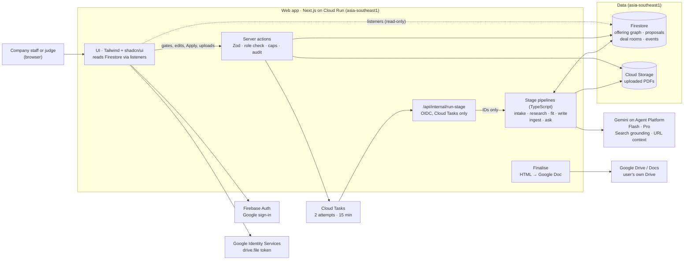
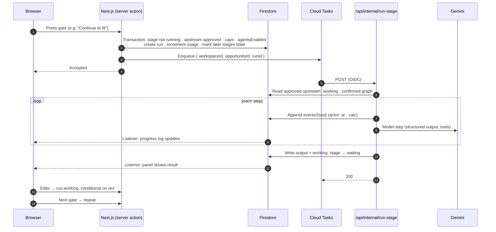

# FlowHub architecture

A one-page map of how FlowHub works. The detail and the reasoning live in the ADRs linked at the end. Last updated 2026-10-13.

FlowHub is the hub for everything a company sells, with GenAI built in, running on Google Cloud (ADR-0008, ADR-0009):

- **The hub:**
  - **Home:** what's waiting for you, and what happened today.
  - **Offerings:** one page per offering, with six tabs: Overview, Scope, Pricing, Partners, Sales material, Notes. Behind them is the offering graph, every item linked to the document page it came from.
  - **Opportunities:** each with its deal room.
  - **Settings:** including the company-wide selling rules.
- **Ask or tell FlowHub:** on every screen. People ask questions, or tell FlowHub what changed in plain language or with a PDF. FlowHub proposes the changes, and a person applies them.
- **The deal room:** each opportunity's record page. Work moves through four stages, and a person approves each stage at a gate before the next one starts.
- **Who did what:** every block is marked AI, Calculated (code, no model), or a person.

Every trust rule (cited research, prices from the catalogue, private cost, public proof only) is **enforced in code**, not left to prompting.

## System overview



**How it hangs together:**
- **Writes:** the browser never writes to Firestore. Every change, including applying a proposal, goes through a server action.
- **Progress:** the browser gets progress only from Firestore listeners.
- **Models:** only server code calls Gemini, using the Cloud Run service identity. Long runs go through Cloud Tasks to the internal route, which runs the pipeline in-process (ADR-0010).

## One stage, end to end



**Retries are safe.** The start transaction guarantees one run per stage, and a repeated call with the same `runId` exits without doing anything. A run with no event for 3 minutes shows as stalled and offers Retry.

**Ask or tell** is shorter. A server action calls the `ask` pipeline directly, because a proposal returns in seconds. It writes a proposal to Firestore with `status: proposed`. Apply is a separate server action, which re-validates every operation before writing.

**A dropped PDF** takes the long path. A server action stores the file and queues an `ingest` job through Cloud Tasks, to the same internal route the stages use. The job reads the pages and writes a proposal of the same shape. The browser follows the file's status through a listener (ADR-0009 D2, as amended).

## Stages and pipelines

| Pipeline | Gate after it | Model steps (tier) | Code steps (marked Calculated) |
|---|---|---|---|
| Intake | A: confirm the prospect | Intake (Flash) | Schema validation, and never guessing a company. A told lead arrives here already filled in |
| Research | B: approve the brief | Snapshot, News and Hiring search (Flash, grounded, in parallel), Tech scan (Flash, URL context), Inferences (Pro) | Claims cut from `groundingSupports`. Unsupported sentences dropped and counted. Inferences must cite kept claims. Search Suggestions stored and shown unchanged |
| Fit + Pricing | C: approve the fit map | Fit Analyst (Pro, whole confirmed outline in context), Pricing (Flash, function calls, selects refs only) | Constraints and Not included checked first. Every ref validated. Score computed by formula. Prices copied from the graph |
| Write + Review | D: resolve flagged claims, finalise | Writer (Pro, SME template), Reviewer (Pro), in a loop of up to 2 | `{{price:…}}` placeholders rendered by code. Hard checks: unknown ref, price not from the graph, non-public proof, **cost leak** |
| Finalise | *(done)* | *(none)* | Renders HTML and creates the Doc with the user's short-lived `drive.file` token. The token is never stored |
| Ask or tell | Apply, by a person | Proposal or answer (Flash, file understanding for PDFs) | Validator: targets exist and are current, no cost fields, every price appears word for word in the source. Totals calculated |
| Ingest (a dropped PDF) | Apply, by a person | Transcription of scanned pages, then a proposal (Flash, file understanding) | Page text read from the PDF. Validator as for Ask or tell, with each price checked against the page it cites. Prices that already match are set aside |

## Data

```
users/{uid}                                                         the user's workspace (server-written)
workspaces/{ws}/
  members/{uid}                                                     role: owner (roles deferred, ADR-0009 D5)
  offerings/ rateCards/ feeSchedules/ proof/ constraints/ partners/   offering graph (ADR-0001, ADR-0009 D1)
  notes/{id}                                                        offering or opportunity notes
  documents/{id}                                                    uploaded PDFs, linked to offerings
  proposals/{id}                                                    Ask or tell and document proposals (ADR-0009 D2)
  answers/{id}                                                      Ask answers and replies that changed nothing (ADR-0009 D2)
  opportunities/{id}/runs/{runId}/events/{seq}                      deal room (ADR-0005)
  usage/{yyyy-mm-dd}                                                daily caps
  auditEvents/{id}
system/flags                                                        kill switch (server only)
```

- **Security rules:** a member reads their own workspace. No client writes anywhere. Nobody reads `system/**` from a client.
- **Provenance:** every graph entity records how it arrived (manual, document, message or import) and who confirmed it. That drives the markers.
- **Runs keep two copies:** the model's `output` is never edited, and the human edits `working`. The next stage reads only approved `working` content.

## Trust invariants and where they're enforced

| Invariant | Enforced in | Proven by |
|---|---|---|
| Research claims have a source | Claim cutting from grounding metadata | Unit test, plus the eval metric "100% sourced" |
| Prices only from the catalogue | Pricing selects refs, code copies values, Writer placeholders. Proposals: prices must appear in the source text | Unit tests, plus eval "100% traceable" and a planted-price message |
| Cost never leaves the seller's view | Typed projections with no cost fields, the cost-string hard check, the validator refusing cost operations | Schema test, plus eval "0 leaks" |
| Only public proof cited | Proof projection, plus the non-public-name hard check | Unit test, plus a planted fixture |
| Unsupported claims block the Doc | Reviewer, hard checks, and the finalise action's own check | Eval "planted claims flagged" |
| Only confirmed graph data | Proposals live outside the graph until a person applies them | Test: a proposed entity never appears in a pipeline's inputs |
| Workspace isolation | Path-scoped collections, rules, server checks | Rules tests in the emulator |

## Deployment and cost controls

| Piece | Where | Notes |
|---|---|---|
| Web app and pipelines | Cloud Run, `asia-southeast1`, via Cloud Build | Scales to zero. Request timeout 15 minutes, for runs |
| Data | Firestore `(default)` Native, and Cloud Storage, both `asia-southeast1` | The free-tier database |
| Queue | Cloud Tasks | Free tier |
| Models | Gemini on Agent Platform, through `@google/genai`. Names pinned in `web/src/server/ai/models.ts` | Gemini 3 or later |

**Cost controls:**
- **Daily caps per workspace:** 10 research runs, 30 stage runs, 20 uploads.
- **`system/flags.agentsEnabled`** is a kill switch that needs no redeploy.
- **A budget alert** is set before the first deploy.
- **The free-trial account** caps spending outright.

## Decisions

| ADR | Decision |
|---|---|
| [0001](adr/0001-offering-graph-data-model.md) | Offering graph data model: typed collections, provenance, one Zod schema |
| [0002](adr/0002-agent-implementation-language.md) | *Superseded by 0010.* Agents in Python ADK |
| [0003](adr/0003-agent-hosting.md) | *Superseded by 0010.* Agent Runtime hosting |
| [0004](adr/0004-ui-component-library.md) | Tailwind v4 and shadcn/ui |
| [0005](adr/0005-deal-room-data-model.md) | Deal-room data model: runs, `output` and `working`, events, caps, server-only writes |
| [0006](adr/0006-agent-design.md) | Stage design: invariants enforced in code, Cloud Tasks |
| [0007](adr/0007-google-docs-access.md) | Google Docs access: a `drive.file` token only when needed, HTML-to-Doc conversion |
| [0008](adr/0008-hub-first-and-light-multi-user.md) | Hub-first product |
| [0009](adr/0009-offering-centred-hub-and-ask-or-tell.md) | Offering-centred hub, Ask or tell, who-did-what markers, one user per workspace for the submission |
| [0010](adr/0010-genai-workflow-in-typescript.md) | Stages as a TypeScript workflow in the web app, Gemini through the Gen AI SDK |
| [0011](adr/0011-local-development-on-a-dev-project.md) | Local development on a separate dev Firebase project; automated Firestore tests on the emulator |
| [0012](adr/0012-three-demo-sellers.md) | Three demo sellers by what they sell: Olvessa Cloud, Yorvex Workforce and Trassoq Hardware |
| [0013](adr/0013-comic-theme-from-the-logo.md) | A comic theme from the logo: ink outlines, hard shadows, yellow primary, hand-lettered headings |

Product requirements are in [product/PRD.md](product/PRD.md).
